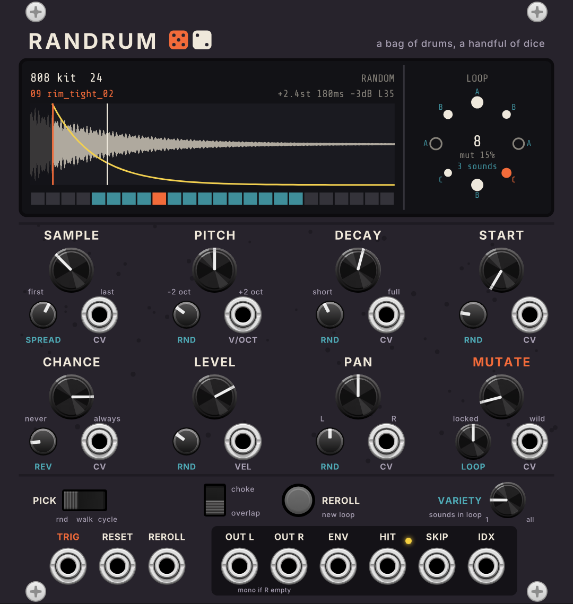

# Randrum

A VCV Rack 2 drum sample player that rolls dice on every hit. Load a folder of
WAV or AIFF files, send it triggers, and each hit picks a sample and a pitch, decay,
start point, level, pan and direction, inside ranges you set with the knobs.
**LOOP** and **MUTATE** turn those dice rolls into a pattern that repeats and
slowly rewrites itself, so a random part can sit still long enough to groove
and then drift somewhere new.

## Getting sound out of it

1. Right-click the module and choose **Load folder...**, or drag a folder (or
   any sample inside it) from Finder onto the screen. Subfolders are included,
   so you can drop a whole sample library.
2. Patch a clock or gate sequencer into **TRIG**, and **OUT L** into your mixer.
3. Turn **SPREAD** down to narrow which samples it picks from, and use
   **SAMPLE** to move that window through the folder.

One Randrum plays one part. Use one for hats, another for perc, another for
kicks, each with its own folder.

## How the dice work

Every trigger uses a set of eight dice: which sample, pitch, decay, start,
level, pan, reverse, and whether the hit plays at all. The knobs decide how far
each die is allowed to push things. Because the dice and the knobs are kept
apart, turning a **RND** knob rescales the same rolls rather than rolling new
ones. A locked pattern stays the same pattern while you make it wilder or
tamer.

- **LOOP** (the small knob under MUTATE): 1-16 hits. The dice for each hit are
  kept in a ring of that length, so the pattern repeats. Fully CCW is **free**:
  new dice every hit.
- **MUTATE**: on every hit, the chance that each die is rolled again. At zero
  the loop is locked. Around 5-15% it changes a little each time round. Full
  CW is pure noise.
- **VARIETY**: how many different samples the loop uses, from 1 up to
  **all** (fully CW, the default). At 3, an 8-step loop uses three sounds,
  each repeated, and a repeat never lands on the step next to itself (around
  the end of the loop too), so you get patterns like `A B A C B C A B` rather
  than `A A B B`. Each sound gets an even share of the steps. Which sounds and
  in what order are part of the dice, so MUTATE changes them slowly and
  REROLL picks new ones. The screen puts the letter of each step's sound
  around the LOOP ring. VARIETY works in **rnd** pick mode (walk and cycle
  already repeat sounds in their own way). With LOOP on free, each hit picks
  one of the VARIETY sounds, never the same one twice in a row.
- **REROLL** (button or gate): roll the whole loop again in one go.
- **RESET**: the next hit is the first of the loop. Patch the bar or pattern
  reset here to keep the loop lined up with your other parts.

## Controls

| Block | Big knob | Small knob | CV jack |
|---|---|---|---|
| **SAMPLE** | Middle of the pick window, first to last file | **SPREAD**: how many files the dice can pick from. CCW = only the SAMPLE file, CW = the whole folder | 0-10 V sweeps the folder |
| **PITCH** | +-2 octaves | **RND**: up to +-12 semitones per hit | V/OCT |
| **DECAY** | 10 ms to 4 s. Fully CW = the whole sample with no envelope | **RND**: up to 8x shorter or longer per hit | 0-10 V |
| **START** | Start point, up to 95% into the sample | **RND**: up to half the sample later per hit | 0-10 V |
| **CHANCE** | Chance that a trigger plays | **REV**: chance a hit plays backwards | +-10 V |
| **LEVEL** | Silent to +6 dB (about 2 o'clock is 0 dB) | **RND**: up to 24 dB quieter per hit | **VEL** 0-10 V (unpatched = full) |
| **PAN** | Left to right | **RND**: random pan width | +-5 V |
| **MUTATE** | See above | **LOOP**: see above | +-10 V |

- **PICK**: **rnd** picks anywhere in the window. **walk** moves one file up or
  down (or stays) each hit, bouncing off the window edges. **cycle** steps
  through the window in order (round robin).
- **choke / overlap**: overlap lets tails ring on under new hits (up to 12 at
  once). Choke cuts the last hit, like an open hat closed by the next one.

## Jacks

| Jack | |
|---|---|
| **TRIG** | Each rising edge is one hit |
| **RESET** | The next hit is step 1 of the loop |
| **REROLL** | Roll the whole loop again |
| **OUT L / OUT R** | Audio, 5 V peak. With nothing in OUT R, OUT L is the mono mix |
| **ENV** | The newest hit's envelope, 0-10 V. Use it to sidechain or to open a filter |
| **HIT** | A trigger every time a hit plays |
| **SKIP** | A trigger every time CHANCE says no. Patch it to another Randrum for call and response |
| **IDX** | Which file played, 0-10 V across the folder |

## The screen

- **Top line**: folder name and how many files it has, then the PICK mode.
- **Second line**: the file that just played (orange, or purple when skipped),
  then its pitch, decay, level, pan and REV.
- **Waveform**: the last file. The orange line is the start point, the yellow
  curve is the decay, white lines are playheads.
- **Strip**: one cell per file. Teal cells are the SPREAD window; orange is the
  one that played.
- **LOOP ring**: one dot per step. Filled dots will play at the current CHANCE,
  hollow ones will be skipped, and bigger dots are louder. Orange is the step
  that just played.

## Right-click menu

- **Include subfolders** (on by default).
- **Load folder...**, **Next folder**, **Previous folder**, **Folders next to
  this one**: handy when your kits sit side by side in one parent folder.
- **Reload folder** after adding files.
- **Random pitch in whole semitones**: makes PITCH RND melodic.
- **Re-roll the whole loop**.

The folder path and the loop's dice are saved with the patch. The samples
themselves are not copied into the patch, so keep the folder where it is.

Up to 1024 WAV or AIFF files per folder, counting subfolders (8/16/24/32-bit
PCM or 32/64-bit float, any sample rate, mono or stereo), up to 30 seconds
each. Files are ordered by their path, so subfolders stay together. If a
folder won't load, the screen says why. "macOS blocks Rack" means Rack needs
permission for that location: System Settings > Privacy & Security > Files and
Folders (or Full Disk Access) > VCV Rack 2. Rack's `log.txt` lists every file
that couldn't be read.

## Building

GitHub Actions tests the engine and builds the Apple Silicon version on every
push to main (see `.github/workflows/build.yml`). The `.vcvplugin` file appears
on this repository's **latest** release page. To build locally, download the
Rack SDK and run `make dist RACK_DIR=/path/to/Rack-SDK`.

- `src/DrumEngine.hpp`: the dice, the loop and the voices, with no Rack code.
- `test/engine_test.cpp`: `c++ -std=c++11 -O2 -o test/engine_test test/engine_test.cpp && test/engine_test`
- `res/make_panel.py`: draws the panel SVG. `tools/preview.py`: renders
  `panel-preview.png`.
